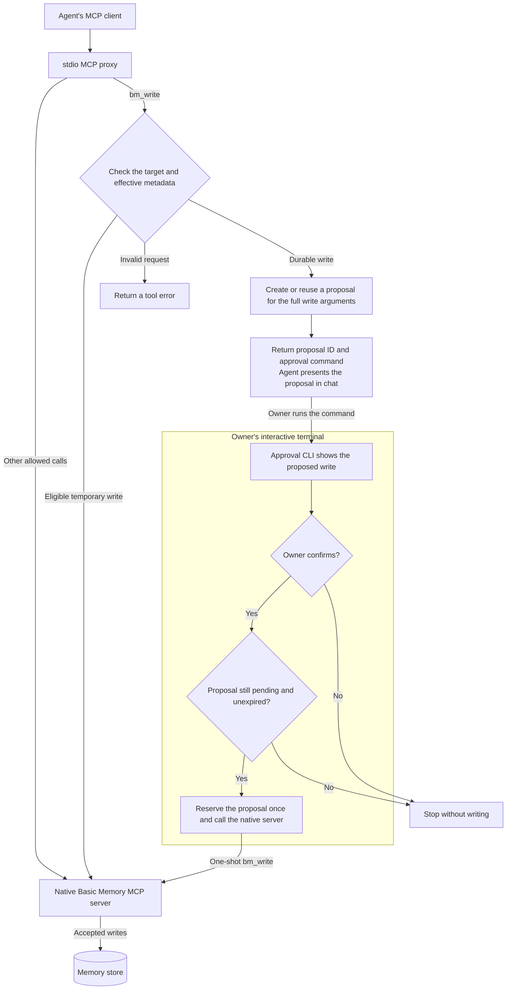

# Require technical approval for durable memory writes

Durable notes must not become durable solely because an agent decided the owner would have approved them. Retrieved notes can carry prompt injection, and the chat convention in [ADR 0002](0002-agent-proposals-with-human-approval.md) cannot distinguish a genuine approval from a model's claim that one happened. This decision supersedes ADR 0002's workflow convention for the productive MCP connection. The agent presents the proposed entry in chat and the owner confirms the write in a terminal they control.

The boundary covers the MCP write path of the productive clients. A stdio MCP proxy in front of the native Basic Memory server intercepts `bm_write` and forwards other methods to the native engine. `bm_edit` stays unexposed, and a durable write without an explicit project is refused so that every approval names a visible target. The CLI requires terminal input and output to prevent confirmation through redirected streams. It trusts the operator of that terminal. Processes with access to the owner's shell, a pseudo-terminal, the proposal files or the store remain outside the protocol boundary.

A temporary creation requires effective `kind: temporary`, `status: active` and a valid UTC `last_activity` in the `temporary/` or `handovers/` folder of an explicitly identified local project. The proxy uses the native project's external ID to pin routing and applies the native precedence of separate metadata over Markdown frontmatter. A checksum-conditional update can set `active`, `completed` or `archived` automatically when the existing revision is a temporary note at that exact path. This allows activity extension, completion, archival and restore. All other writes require approval. Durable content deliberately described as temporary remains an accepted residual risk.

`bm_write` keeps its tool surface. For a durable target the proxy performs no store write and returns a normal tool result with the proposal identifier and approval command. The agent presents the proposal in chat and continues working. A proposal binds the write arguments and their content hash to an explicitly resolved project UUID. A qualified identifier is stored as a path relative to that project. A proposal expires after 24 hours and is valid once. Resubmit proposals created before project UUIDs were recorded. Identical write arguments reuse an open proposal. Creation uses `overwrite: false`. Updates require `expected_checksum`, which the native engine revalidates when the approved write runs ([ADR 0008](0008-concurrent-sessions-with-conflict-detection.md)).

The owner CLI lists, approves and rejects proposals. Before confirming, the owner sees the project name, UUID, target arguments, content and source. After confirmation the CLI checks the proposal again and reserves it under the proposal lock before calling the native MCP server. The native session checks that it can address the approved UUID before submitting the write. Requests have deadlines. After graceful shutdown, the CLI verifies the local Markdown file against the path and checksum returned by the native write. A preflight failure leaves the proposal pending. An unverified write remains reserved. Check the store before proposing the write again. Proposal and approval events go to a dedicated private JSONL file under `$HOME/SharedMemory`, separate from the [ADR 0012](0012-automatic-lightweight-handover-observations.md) observation log.

The gate's code and its configuration template live in this repository, with the local configuration gitignored. The productive client connection is redirected to the gate by changing the existing tracked toolbox configurations, which keep absolute-path placeholders; operational and evaluation launchers keep using the native server. Switching the productive clients requires explicit owner approval and follows implementation and disposable-store verification. ADR 0002 remains as the historical decision, superseded by this one.

## Proxy and approval flow

