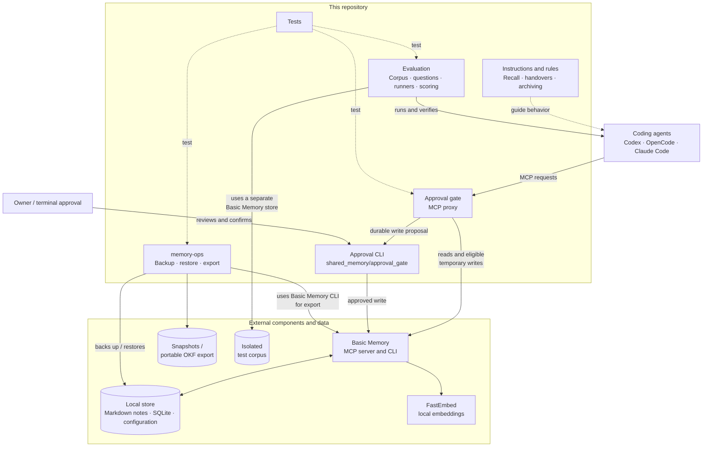

# Component diagram

The repository extends Basic Memory with an approval gate, backup and export tools, and a separate evaluation environment.

The evaluation uses a separate corpus to check client tool use, note retrieval and reads, and corpus integrity. See [Repository architecture](repository-architecture.md) for details.
