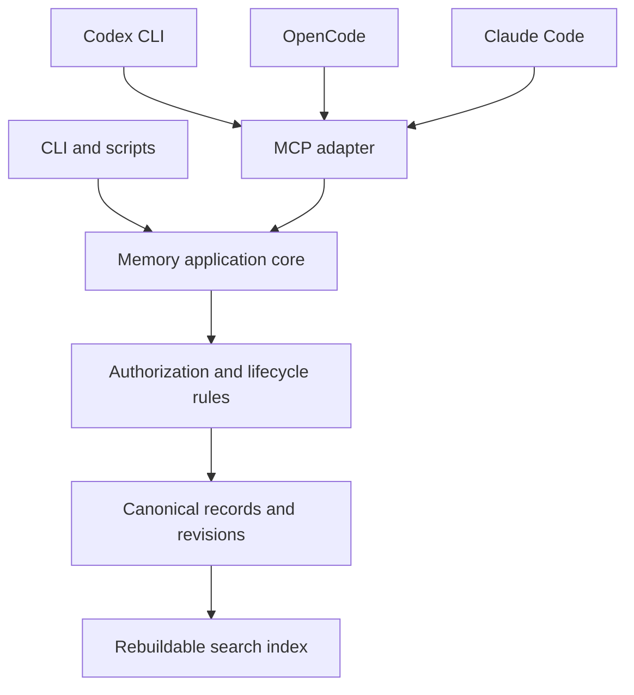

# Harness-independent shared memory for coding agents

**Status:** Architecture proposal and open-source landscape review  
**Research date:** 14 November 2026  
**Target clients:** Codex CLI, OpenCode, and Claude Code  
**Rollout:** Personal use first; controlled team adoption second

## 1. Recommendation

Create a shared knowledge layer outside the coding-agent harness. Expose it through MCP and a CLI, retain portable records with provenance, and keep client-specific integrations small.

**Evaluate existing software before implementing a new memory engine.** Start with Basic Memory for a read-only, personal recall experiment using a curated corpus. Enable agent capture only after proposal review, revision safety, and handover retrieval pass separate gates. Compare Vectorize Hindsight if automatic extraction and richer recall become important, or DrDroidLab Hindsight for reviewed operational knowledge. Add a policy adapter only for demonstrated gaps.

The architecture below is the target contract. It is not a claim that any evaluated product already implements every requirement. The first experiment tests recall value; it does not establish compliance with the capture or team contract. Section 8 defines its explicit exceptions, and Section 13 defines the gates for proceeding.

## 2. Scope and independence

Shared memory means durable facts, decisions, lessons, and temporary handovers that can be reused across sessions and clients. It does not transfer a model's live context window or hidden reasoning.

Independence has four dimensions:

| Dimension | Requirement |
| --- | --- |
| Harness | Each target client can retrieve and propose knowledge through a public interface. |
| Model | The target supports storage and keyword retrieval without inference. Optional enrichment uses an explicit provider/model configuration. Any candidate requiring background inference must be recorded as a departure from this target. |
| Data | Records, revisions, provenance, and relationships can be exported in documented formats. |
| Hosting | Personal deployment works locally; team deployment can run on infrastructure under the team's control. |

MCP standardizes access to tools and resources, not the memory schema or the agent's retrieval behavior. Client support therefore does not guarantee automatic recall. [S1]

Non-goals for the first stage: storing all transcripts, orchestrating agents, replacing issue tracking, indexing every repository, and synchronizing live databases between laptops.

## 3. Reference architecture



The core owns validation, scope resolution, lifecycle transitions, concurrency, and audit events. Both interfaces use the same rules. Agent plugins and hooks provide convenience around this core.

Two storage implementations are acceptable:

- **Database-backed:** SQLite initially; PostgreSQL for a central team service. Portable export includes history and metadata.
- **Document-backed:** Markdown records with structured metadata are canonical; a database indexes them. Writes require atomic updates and revision checks. Git may provide review and history.

Choose one canonical representation. Avoid a design where files and database rows are independently writable authorities with ambiguous conflict resolution.

## 4. Knowledge boundaries

| Scope | Examples | Default audience | Lifetime |
| --- | --- | --- | --- |
| Personal | Preferred workflow, personal lessons | Owner only | Until revised |
| Project | Architecture rationale, recurring build pitfalls | Authorized project members | Periodically verified |
| Team | Shared engineering conventions and operational lessons | Authorized team members | Periodically verified |

Handover is a content kind, not a visibility scope. A handover is personal by default and may be explicitly shared with an authorized project. It carries unfinished work and hypotheses, expires after seven days by default, and never becomes accepted knowledge merely by being saved. Arbitrary person-to-person sharing is outside the first pilot.

Scope expresses intended visibility; authorization enforces it. A project name, memory-bank identifier, or search tag alone is not an access-control boundary.

Personal and employer knowledge should use separate deployments or credentials and stores from the beginning. Moving to a team must never publish private entries automatically. Publication is an explicit, reviewed operation with a new destination identity and a provenance link.

Repository documentation remains authoritative for current build instructions and binding project rules. Memory captures explanations and lessons and links to the relevant commit, file, issue, or decision record. When they disagree, surface the conflict and verify the current repository state.

Examples for embedded/DevOps work:

- Durable: why a Yocto layer arrangement was selected, including alternatives and the decision source.
- Durable: a verified Jenkins failure pattern, the affected versions, and the evidence for the fix.
- Temporary: an investigation currently blocked on a test on a particular branch and commit.

## 5. Portable record contract

| Field | Purpose |
| --- | --- |
| `id`, `revision`, `schema_version` | Stable identity, concurrency, migration |
| `scope`, `owner_id`, `project_id`, `team_id` | Ownership and audience; project/team identifiers are required for their respective scopes |
| `kind`, `title`, `body`, `tags` | Typed content and discovery |
| `sources` | Evidence with URI/path, source revision, and optional excerpt |
| `status` | Durable revisions: `accepted`, `superseded`, or `expired`; handovers: `active`, `completed`, or `expired` |
| `created_by`, `created_at`, `updated_at` | Accountability and chronology |
| `accepted_by`, `accepted_at` | Reviewer and decision time for each accepted durable revision; absent on handovers |
| `verified_at`, `expires_at` | Evidence freshness and bounded validity; `expires_at` is mandatory for handovers |
| `supersedes`, `derived_from` | Relationships referencing both record ID and revision |
| Optional environment constraints | Branch, commit, tool version, hardware, operating system |

Use an explicit project UUID mapped to approved repository identities and local checkouts. Do not use the local directory path as the sole project identifier. Repository renames and multiple worktrees must preserve identity.

Proposals are separate from accepted records. Each stores `proposal_id`, `target_id`, `base_revision`, the complete candidate content and metadata, `proposed_by`, `proposed_at`, and a status of `proposed`, `accepted`, or `rejected`. For a new record, the service reserves a target ID and uses `base_revision: null`; for an edit, it records the current durable revision being replaced, including when that revision has expired. Candidate content is immutable after submission; corrections require a new proposal. Review outcomes retain the reviewer, time, reason, and resulting record revision when accepted. Exports include proposals and review history.

Example accepted record, using illustrative rather than product-specific syntax:

```yaml
schema_version: 1
id: mem_01_example
revision: 1
scope: project
project_id: project_embedded_demo
owner_id: example-owner
kind: lesson
title: Verify the generated CI configuration before changing the pipeline
body: >-
  In this example project, inspect the generated configuration when a
  pipeline behaves differently from the checked-in template.
status: accepted
sources:
  - uri: repo://embedded-demo/docs/ci.md
    revision: example-commit
created_by: example-owner
created_at: 2026-11-14T10:00:00Z
updated_at: 2026-11-14T10:00:00Z
accepted_by: example-owner
accepted_at: 2026-11-14T10:00:00Z
verified_at: null
expires_at: null
tags: [ci, troubleshooting]
```

In the pilot, durable knowledge requires an explicit human acceptance decision. Evidence supports that decision; it does not automatically authorize publication. Acceptance and verification are distinct: `verified_at` remains null unless the evidence was actually checked. A model-assigned confidence score is not verification.

## 6. Interfaces and agent behavior

Keep the initial agent tool surface small:

| Proposed operation | Behavior |
| --- | --- |
| `memory.search` | Default `view="knowledge"` returns only accepted, unexpired, applicable knowledge in permitted scopes. Explicit `view="handovers"` returns active, unexpired handovers labeled as unreviewed work. Both return bounded snippets with source, revision, and freshness. |
| `memory.get` | Retrieve an authorized record/revision or proposal by ID, preserving its status and provenance. |
| `memory.propose` | Submit a separate durable-knowledge proposal with `base_revision` and an idempotency key; never mutate the accepted record. |
| `memory.save_handover` | Create or update an authorized handover, or mark it completed; require an idempotency key and `expected_revision` for updates. Cannot change an existing record's kind, owner, or scope, or grant acceptance rights. |

Administrative functions cover acceptance, rejection, publication, supersession, export, and deletion. Initially, agents cannot invoke those functions with their normal credentials.

This separation requires a real execution boundary when enforcement is claimed. Agents must not have reviewer credentials, unrestricted backend APIs, or write access to canonical files through their shell. A local stdio server running as the agent's OS user does not provide that boundary by itself. The read-only experiment below assumes a trusted owner; enforced capture and team deployment must protect these bypass paths.

These names describe the desired contract. Existing products may use different tools. Introduce a facade only when it provides useful policy enforcement or portability; do not duplicate a working product API merely to rename tools.

Common agent instructions:

1. At task start, resolve the project, search accepted decisions and lessons, and separately look up handovers for the current project/task. Check their branch and commit against the checkout before resuming work.
2. Retrieve complete records only when needed; inspect sources before relying on consequential claims.
3. Search again when a new subsystem or unfamiliar failure becomes relevant.
4. At a useful milestone, propose durable findings with evidence. Keep unresolved hypotheses clearly labeled.
5. Save unfinished work through `memory.save_handover`. Include project, branch, base commit, a summary of uncommitted work, outstanding checks, and the next action. Mark the handover completed when resolved; propose any durable lesson separately.

OpenCode and Claude Code document MCP connectivity; Codex MCP management was also checked through the installed CLI during concept preparation. Exact configuration and hook behavior must be validated against pinned client versions. [S2, S3]

Maintain a common instruction template and small host-specific files. Optional hooks may request a startup briefing or checkpoint, but explicit tool/CLI calls remain the fallback. Do not assume that all three clients provide identical lifecycle events.

Built-in harness memory may coexist as a local cache or scratch area. Avoid uncontrolled bidirectional synchronization between those stores and the shared system.

## 7. Retrieval, lifecycle, and concurrency

Start with full-text search plus scope, project, type, and validity filters. Default knowledge recall excludes proposals, superseded/expired revisions, and inapplicable environment constraints; freshness ranks the remaining accepted records. Return a handful of snippets within an initial combined budget of roughly 2,000 tokens for knowledge and handovers; measure whether that budget is sufficient.

Add semantic ranking only after a small evaluation set demonstrates missed paraphrases. Distinguish query mode from background indexing: selecting text search does not disable embedding generation. Record any unavoidable inference in the candidate evaluation. Embeddings and reranking results must be rebuildable; persist provider, model/version, and index configuration when used.

Authorization must constrain the search candidate set and every subsequent fetch. Apply it to vector search, graph traversal, counts, snippets, caches, and exports as well.

Submitting or rejecting a proposal leaves the current accepted revision available and unchanged. Acceptance requires a pending proposal, checks its stored `base_revision` against the current durable revision, and atomically appends the new immutable content revision, supersedes the previous one, and records the decision. For a new target, acceptance requires that no record already exists. A mismatch leaves the proposal pending and returns a conflict; the reviewer must obtain a new proposal against the current revision. Changing a proposal's base without reviewing its content is not a rebase.

For example, two proposals based on revision 4 can coexist. Accepting one creates revision 5; accepting the other must fail even if the reviewer has just fetched revision 5. The comparison uses the proposal's original base. Conflicting claims in separate accepted records are presented as a conflict, not silently consolidated. Branch-specific evidence does not become globally applicable without review.

All writes use transactions or equivalent atomic document updates. Handover updates also reject stale `expected_revision` values. Idempotency keys are scoped to authenticated caller and operation: retries return the original result, while reuse with a different payload fails. Retrying acceptance of an already accepted proposal returns its original resulting revision.

Handovers follow `active → completed/expired` independently of durable review. The handover view returns unreviewed context immediately to its authorized audience; branch/commit mismatches are visible and require checking the working tree. A handover is a continuation aid, not a snapshot that recreates uncommitted files. Learning from it requires a separate durable proposal and review.

Expiry is checked against `expires_at` at read time, including cached/indexed results, without depending on a cleanup job or destroying history. Completed handovers and superseded revisions are also excluded from ordinary recall. Deletion is a separate operation and must cover derived indexes and caches; backup retention and Git history need explicit handling.

## 8. Stage 1: personal deployment

Keep the curated corpus in one repository, with one owner and one writer host. Exercise global read-only retrieval during real work across at least two repositories under section 13's everyday-use gate. Separate personal preferences from project records even when both belong to the same user. Run the pilot in two phases:

| Phase | Concrete setup | What passing establishes |
| --- | --- | --- |
| **1A: recall experiment** | The owner seeds 20–30 reviewed, non-sensitive records with sources and stable IDs. Only accepted, currently applicable entries are indexed. Expose only read/search tools to all three clients; disable native write, edit, move, delete, and project-management tools. The owner maintains the corpus. | Whether cross-client recall is useful. Agent capture, automatic lifecycle filtering, review enforcement, concurrent writes, complete revision-history portability, and multi-user authorization are explicitly deferred. |
| **1B: controlled capture** | Enable proposal submission and handovers only through interfaces satisfying Sections 5–7. Use an existing reviewed workflow or the smallest adapter needed; keep native mutation paths inaccessible to agents. The owner reviews durable proposals using separate reviewer access. | Safe cross-client capture and resumption, including stale approvals, expiry, retry behavior, and complete export/restore. |

For 1A, verify each client's effective tool list. Client allowlists establish the experiment's workflow, not an authorization boundary against shell access. Do not introduce protected employer data or other users on that basis. If tool restriction cannot be verified, do not enable the unrestricted server. Passing 1A is a reason to evaluate 1B, not permission to turn on Basic Memory's native write tools.

Basic Memory's documented default install includes semantic dependencies and generates embeddings when supported. For 1A, explicitly use text query mode and accept local background embeddings as a documented exception to the no-inference target; do not describe this as a model-free baseline. Record the pinned release, actual provider/model, initial download, indexing time, and memory use. Configure no hosted embedding provider. If a no-inference deployment is mandatory, require a verified supported configuration or choose another engine before starting. [S15]

The embedding exception ends at 1A. Before 1B, demonstrate storage and keyword recall with inference disabled or unavailable. If the selected release cannot do that, choose an engine that can, or explicitly revise the model-independence requirement before adopting it.

For a custom fallback, use Python packaged with `uv`, SQLite full-text search, and MCP/CLI clients of the same application core. In 1B, run the core with protected storage and separate reviewer access; a local stdio bridge must not give the agent direct access to those files or credentials. Existing software can replace this implementation.

Keep SQLite on a local filesystem and use supported consistent backups. Do not sync a live SQLite/WAL database with Syncthing or place it on a shared network filesystem. SQLite documents the same-host restriction for WAL. Sync completed backups or exported documents instead. [S4]

Document-based sync also needs conflict handling: two laptops editing the same note can diverge. The first pilot uses one writer host. If simultaneous access from multiple devices is needed, use a central service rather than improvising database replication.

If the memory service is unavailable, continue coding with a visible notice that memory was unavailable. Do not silently create a second authoritative store.

## 9. Stage 2: team deployment

| Concern | Team requirement |
| --- | --- |
| Hosting | Central service over HTTPS; PostgreSQL or an appropriately managed document-backed service |
| Identity | Individual credentials; integration with the organization's identity provider |
| Authorization | Project membership, reader/contributor/reviewer roles, server-side enforcement |
| Publication | Explicit promotion of selected knowledge into shared scopes |
| Audit | Attributable proposal, review, publication, and deletion events |
| Operations | Backups, restore drill, monitoring, schema migrations, pinned releases |
| Offline behavior | No shared writes offline initially; private drafts are imported as proposals |

Derive identity from authenticated credentials, never a caller-supplied `user_id`. Enforce review rights independently of contribution rights. A reverse proxy that authenticates users is insufficient unless authorization is enforced throughout the application.

Retrieved memory is evidence-bearing data, not an instruction source with authority over the agent. Exclude secrets and raw transcripts by default; automated redaction assists review but cannot guarantee removal. Self-hosting the store does not prevent retrieved content from reaching the selected model provider.

## 10. Open-source landscape

This is a documentation-based review, not an installation, benchmark, or security audit. Licenses below refer to the named repositories; dependencies, model weights, and commercial services have separate terms. Pin a release and inspect its actual license and feature set before adoption.

| Project | Published license | Existing capability | Fit and remaining work |
| --- | --- | --- | --- |
| **Basic Memory** | AGPL-3.0 | Local Markdown knowledge base, MCP, CLI, search, SQLite/PostgreSQL support | First candidate for phase 1A. Native mutation tools do not establish proposal-only review; default background embeddings depart from the no-inference target. [S5, S15] |
| **Hindsight — Vectorize** | MIT | Memory engine, MCP, SDKs/CLI, retain/recall/reflect, coding-agent integrations | Compare for automated extraction. Evaluate model cost, authentication configuration, and enforced bank access. [S6, S7] |
| **Mem0** | Apache-2.0 | Memory library and self-hosted server; separate managed platform | Building block for a customized service. Validate local MCP routing and policy coverage. [S8, S9] |
| **Graphiti** | Apache-2.0 | Temporal knowledge graph and MCP server | Useful for relationship-heavy evolving facts; adds graph infrastructure and model dependencies. [S10] |
| **MCP reference memory server** | Check the pinned component/repository license | Entity/relationship/observation storage and MCP tools | Good protocol prototype; insufficient evidence here for the proposed team governance contract. [S11] |
| **Hindsight — DrDroidLab** | MIT, as stated by its documentation | Git-backed operational knowledge, proposal review, MCP/CLI | Relevant DevOps-oriented candidate; verify deployment, project isolation, and maintenance before selection. [S12] |

### Basic Memory

Human-readable Markdown and existing MCP/CLI access reduce initial implementation work. Its native tools include direct writes, edits, and deletion, so a `status: proposed` metadata convention alone does not enforce the target contract. The repository also documents a Claude Code plugin; defer automatic capture hooks until phase 1B. The advertised cloud team workspace does not establish equivalent self-hosted authorization. Pin the OSS release, disable automatic upgrades, and evaluate it under the phase-specific exceptions above. [S5, S15]

### Vectorize Hindsight

Its memory-bank model and existing agent integrations warrant a comparison if deliberate note capture proves too manual. Extraction and reflection introduce model processing. The configuration documentation states that authentication is disabled by default and describes extensions for advanced authentication. Bank names must not be treated as permissions. Test the selected deployment explicitly. [S6, S7]

### Mem0

Distinguish the OSS library, self-hosted server, and hosted platform. The current repository documents a self-hosted server with authentication/API keys. The hosted MCP documentation requires a platform account; that route alone does not meet a self-hosting requirement. Scope fields in an API need server-enforced authorization. [S8, S9]

### Graphiti

Choose it when temporal relationships are a demonstrated need. Its MCP documentation calls the server experimental and requires a graph backend plus configured inference and embedding providers. That is a larger operational commitment than the first pilot needs. [S10]

### Reference server and operational alternative

The MCP reference memory server is a useful baseline for understanding graph-oriented tools, but review, provenance, and team isolation still require evaluation or additional implementation. [S11]

DrDroidLab Hindsight documents reviewed operational lessons backed by Git and SQLite indexing, with a model-free capture/review/full-text path. It is a distinct project from Vectorize Hindsight. Treat it as an additional candidate, not an interchangeable distribution. [S12]

### OpenMemory naming and maintenance caveat

The former Mem0 OpenMemory MCP server/dashboard is now in `mem0ai/openmemory/openmemory-archive`; its README says it is no longer actively maintained. The current `mem0ai/openmemory` project describes a CLI/TUI for transferring coding sessions across Claude Code, Codex, and OpenCode. That can complement handovers but is a different capability from a governed shared knowledge service. Do not adopt the old deployment from an outdated tutorial. [S13, S14]

## 11. Reusable infrastructure

Use an official MCP SDK for the protocol layer, SQLite/PostgreSQL for transactional storage, and optionally PostgreSQL full-text search or pgvector for team retrieval. Reuse an existing organizational identity provider rather than creating account management.

For reviewable project knowledge, Git pull requests can provide a first approval workflow. This works particularly well with document-backed records, provided ingestion excludes unapproved branches and writes are serialized. Git history is not a per-record confidentiality mechanism and makes permanent deletion more involved.

These are implementation options, not additional services required for the first pilot. A vector database, graph database, event bus, and extraction model should each earn their operational cost through measured need.

## 12. Build-versus-adopt decision

1. **Run Basic Memory phase 1A first.** Restrict its interfaces to recall and measure value against a curated corpus, recording the background-embedding exception.
2. **Record concrete gaps before enabling capture.** Map each phase 1B requirement to a native capability, verified configuration, or missing enforcement. Separate missing behavior from configuration errors and agent failures to call tools.
3. **Compare one alternative when justified.** Choose Vectorize Hindsight for extraction/recall automation, or DrDroidLab Hindsight for reviewed operational knowledge. Avoid running several competing stores in parallel as production authorities.
4. **Add a policy service only if the gap is small.** It must own proposal state, acceptance checks, handover visibility, and policy enforcement on every path that needs them. If agents retain direct write access to the underlying engine or canonical files, it can be bypassed. If the adapter would implement most of the lifecycle or become a second canonical store, compare another engine or the custom fallback instead of calling it a thin wrapper.
5. **Build a custom core only for unresolved requirements.** The original SQLite-to-PostgreSQL design remains a fallback, not the default development project.

## 13. Acceptance criteria and rollout gates

Later phases retain earlier gates, except that the 1B review boundary replaces 1A's read-only tool restriction. A deferred test is not a passed test. A deliberate change to the target requirements must be recorded before evaluating a candidate against the revised gates.

| Gate | Test | Required outcome |
| --- | --- | --- |
| 1A | Cross-client recall | All three clients retrieve the same owner-curated entries; a task without an explicit reminder demonstrates startup recall in each client. |
| 1A | Evidence | Results expose stable identity and source revision; the source is available for inspection. |
| 1A | Retrieval quality | At least 16 of 20 fixed representative questions find the intended entry in the first five results. Use the same corpus and questions in each client; record the actual tool queries and irrelevant results. Include additional no-answer questions to check that the agent recognizes missing evidence. |
| 1A | Experiment configuration | Effective tool lists are read-only; release, query mode, and any background inference are recorded. |
| 1A | Recovery and outage | Restore the curated documents/metadata and rebuild indexes. A service outage is visible and does not silently fork the knowledge base. |
| 1A | Everyday use | Global retrieval access is exercised during normal work until the minimum observation is reached: at least 10 recall-relevant work sessions across at least 2 repositories over at least 7 days. Success requires at least 3 documented useful recalls (task, query, note used, avoided investigation, estimated saving), at most 2 missed recalls of accepted content that should have surfaced, fewer false recalls than useful recalls, no retrieval abandoned because of latency (latency recorded per retrieval), and maintenance effort below the documented saved investigation time; discovered wrong accepted entries are corrected or captured as proposals before the evaluation closes. After 10 recall opportunities without a single useful recall, the trial may be judged failed early. |
| 1B | Model independence | Basic storage and keyword retrieval work with inference disabled or unavailable; semantic ranking and extraction remain optional. |
| 1B | Cross-client capture | Propose in each client, accept through reviewer access, and retrieve the accepted revision in the other two. |
| 1B | Pending edits | An open or rejected revision proposal leaves the accepted body and its default search visibility unchanged. |
| 1B | Stale approval | Submit two proposals against the same revision, accept one, then attempt the other: the second conflicts and cannot overwrite the first. |
| 1B | Handover | Save in client A and resume in B without reviewer approval. Show unreviewed status and checkout mismatch; completed/expired handovers disappear from the active view and never appear in accepted knowledge recall. |
| 1B | Lifecycle and retries | Proposed, superseded, expired, and inapplicable knowledge is excluded from default recall, including cached results. Stale handover updates fail; proposal, handover, and acceptance retries do not duplicate changes. |
| 1B | Review boundary | Agent access cannot accept, publish, delete, or mutate accepted records through MCP, CLI, backend APIs, or writable canonical files; reviewer access can perform the authorized operations. |
| 1B | Portability and recovery | Export/import and backup restore preserve record identities, revisions, proposals, decisions, relationships, and handovers; rebuilt indexes expose only eligible records. |
| Team | Scope and roles | With two real identities and two projects, exercise allowed reads/contributions and denied reads/reviews, including bodies, snippets, counts, history, caches, and exports. Verify publication is explicit and destination access does not expose private provenance content. |

Run 1A against the everyday-use gate above instead of a fixed waiting period. Preparing phase 1B — mapping each 1B gate requirement to a native capability, verified configuration, or concrete gap — may start in parallel, but enabling capture stays gated on both the everyday-use result and the unchanged 1B gates. Record useful recalls, missed recalls, false recalls, corrections, latency, and indexing cost. Compare repeated tasks with the normal repository-documentation workflow to establish whether recall saves investigation time. In 1B, also measure review effort and successful handover resumptions. This replaces the earlier recommendation to run 1A for roughly two weeks before spending effort on 1B; the change was approved and recorded on 15 November 2026, before evaluating any candidate against the revised gates. Proceed to team adoption only after all gates pass on the selected deployment, including a restore drill and the two-identity access tests.

The key decision is whether shared memory reduces repeated investigation enough to justify maintaining it. Good provenance and predictable retrieval matter more initially than automatic accumulation.

## 14. Sources

Primary project documentation inspected on 14 November 2026. Links to `main` and live documentation can change; the implementation evaluation should retain pinned commit/release references.

- **S1:** [MCP architecture](https://modelcontextprotocol.io/specification/2025-11-25/architecture)
- **S2:** [OpenCode MCP servers](https://opencode.ai/docs/mcp-servers/)
- **S3:** [Claude Code MCP](https://code.claude.com/docs/en/mcp) and [memory documentation](https://code.claude.com/docs/en/memory)
- **S4:** [SQLite write-ahead logging](https://www.sqlite.org/wal.html)
- **S5:** [Basic Memory repository](https://github.com/basicmachines-co/basic-memory) and [license](https://github.com/basicmachines-co/basic-memory/blob/main/LICENSE)
- **S6:** [Vectorize Hindsight repository](https://github.com/vectorize-io/hindsight) and [coding-agent integrations](https://github.com/vectorize-io/hindsight/blob/main/hindsight-integrations/coding-agents/README.md)
- **S7:** [Vectorize Hindsight configuration](https://hindsight.vectorize.io/1.1/developer/configuration)
- **S8:** [Mem0 repository and self-hosted server overview](https://github.com/mem0ai/mem0)
- **S9:** [Mem0 hosted MCP documentation](https://github.com/mem0ai/mem0/blob/main/docs/platform/mem0-mcp.mdx)
- **S10:** [Graphiti repository](https://github.com/getzep/graphiti) and [MCP server documentation](https://help.getzep.com/graphiti/getting-started/mcp-server)
- **S11:** [MCP reference memory server](https://github.com/modelcontextprotocol/servers/blob/main/src/memory/README.md)
- **S12:** [DrDroidLab Hindsight project documentation](https://drdroidlab.github.io/hindsight/) and [FAQ](https://drdroidlab.github.io/hindsight/faq/)
- **S13:** [Archived Mem0 OpenMemory server notice](https://github.com/mem0ai/openmemory/blob/main/openmemory-archive/README.md)
- **S14:** [Current Mem0 OpenMemory project](https://github.com/mem0ai/openmemory)
- **S15:** [Basic Memory semantic search, defaults, and embedding configuration](https://github.com/basicmachines-co/basic-memory/blob/main/docs/semantic-search.md)
